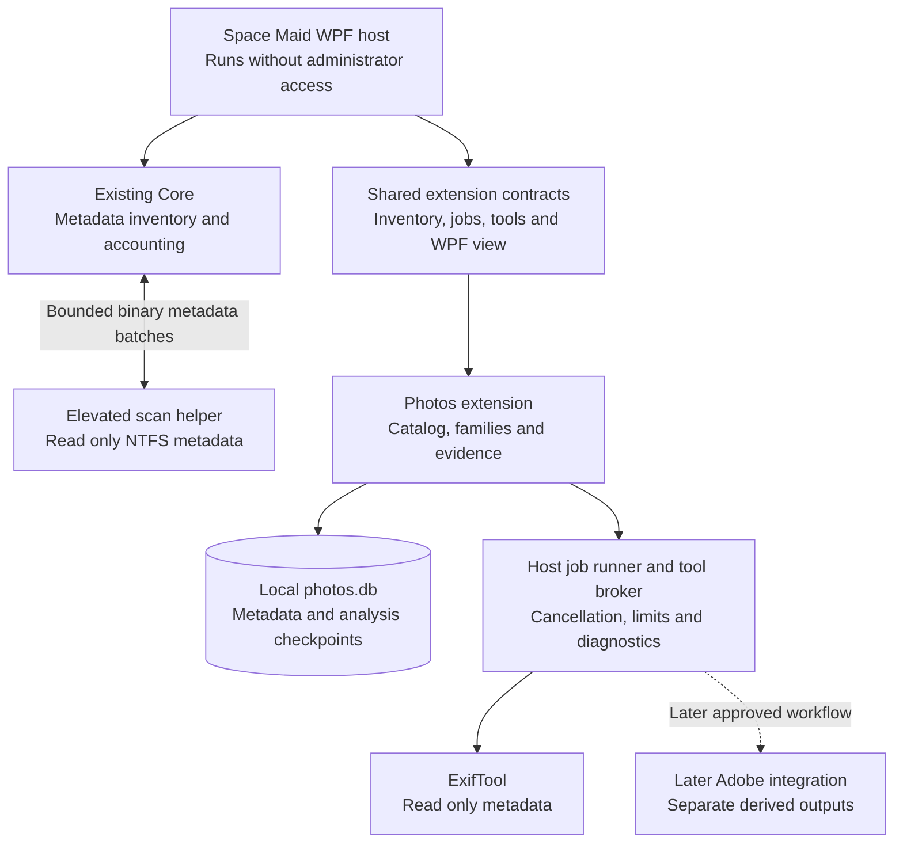

# Space Maid extensions and Photos architecture proposal

Space Maid should keep its fast storage scanner and add specialized workflows through trusted .NET 10 WPF extensions. The first extension would be Photos: selected photo collections, persistent evidence, and review of duplicates and related files. Expensive image reads, hashing, and external tools would run as separate jobs after discovery.

**Status: approved first milestone, implemented in the source tree.** The user approved the architecture, Photos layout and initial resource limits. The implementation covers stages 1–4 below; current verification and limits are recorded in the README. Tool installation, Adobe integration, conversion and photo cleanup remain outside this milestone. The supplied *Media Library Optimizer* PDF is research input; its broader standalone photo/video release scope is not a requirement for this Photos extension.

## Proposed boundaries

| Owner | Responsibility |
| --- | --- |
| Existing `SpaceMaid.Core` | Fast/standard metadata discovery, compact inventory, hard-link accounting, coverage, existing development detection. |
| Existing `SpaceMaid.App` | Fluent shell, extension loading, inventory adapter, bounded job runner, tool process ownership, diagnostics, navigation and review presentation. |
| New `SpaceMaid.Extensions.Contracts` | Small versioned shared API targeting .NET 10 Windows/WPF. No scanner internals or Photos schema. |
| New `SpaceMaid.Extensions.Photos` | Photo views, local catalog/schema, relationships, analysis algorithms, thumbnails and durable job checkpoints. References Contracts, not App or Core. |
| New `SpaceMaid.ScanHelper` | Privileged NTFS metadata acquisition using the existing backend. References Core only; loads no extensions or media tools. |

Keep extension runtime code inside App initially. A separate platform project, generic database service, event bus, marketplace, and hot reload are unnecessary for this first workflow. Existing development findings remain built in; adapting them to the same extension contract can follow only when another workflow needs that change.

## Loading and trust

An extension consists of a manifest, an entry DLL, its `.deps.json`, and dependencies in its own directory. The manifest supplies a stable ID, name, version, contract version, entry assembly/type, and declared tools. Bundled Photos ships in the app's `Extensions` directory. Additional trusted local extension directories are explicitly enabled by the user; opening a scanned folder never loads a DLL from it.

Validate manifest compatibility and entry paths before loading. Load each extension with its own `AssemblyLoadContext` and `AssemblyDependencyResolver`; resolve the shared Contracts assembly from the host's default context. WPF/framework assemblies also remain shared. This avoids duplicate contract types and allows private managed dependencies, following the [Microsoft plugin pattern](https://learn.microsoft.com/en-us/dotnet/core/tutorials/creating-app-with-plugin-support).

Enable, disable, and update take effect after restart. A disabled extension is not loaded, and its catalog is retained. There is no live-unload mechanism in the first version. Loading or job exceptions produce an extension-specific failure and diagnostics; exceptions in trusted UI/native code can still terminate the app.

**Only trusted personal extensions are supported initially.** An assembly load context isolates dependency resolution; it is not a security sandbox. A loaded DLL has the process's filesystem permissions, regardless of declared capabilities. Read-only mode is a contract followed by shipped code, not OS enforcement against arbitrary DLLs. Untrusted plugins would require a separately designed OS isolation boundary; that is outside this proposal. [Microsoft explicitly identifies this limitation](https://learn.microsoft.com/en-us/dotnet/core/tutorials/creating-app-with-plugin-support).

## Administrator access

The WPF host stays unelevated, and **Enable fast scanning** requests UAC for the fixed bundled scan helper. Cancelling UAC leaves standard scanning available. Whole-app administrator relaunch has been removed; a manually elevated host blocks extension loading and media tools until reopened normally.

The helper accepts only a local NTFS volume scan request, cancellation, and shutdown. It performs the documented metadata query, sends size-bounded binary batches plus query diagnostics, and exits after the scan. Parsing, aggregation, preliminary results, and the final compact inventory remain in Core within the host. Do not construct two full inventories or serialize millions of file/path objects as JSON.

Use a session-scoped named pipe restricted to the launching user, verify the launched peer process, and version/validate frames and volume requests. Bound queued batches; a lost connection ends the helper's work. It exposes no file-content reads, arbitrary control codes, shell commands, plugins, or cleanup. If acquisition fails, discard its partial backend and use the existing fallback behavior. Benchmark the transport overhead against the current scanner before claiming equivalent performance.

If the application is launched manually as administrator, do not load extensions or launch their tools until it is reopened without elevation. Starting a normal child process from the elevated app does not establish an unelevated boundary.

## Minimal extension API

The initial contract needs an extension descriptor, initialization/disposal, creation of a WPF workflow view, and the following host services. It does not expose `MainWindow`, mutable `ScanSnapshot` arrays, raw volume handles, or the current folder deletion service.

| Service | Required behavior |
| --- | --- |
| Inventory reader | Pull bounded metadata batches for selected roots; query coverage and allocation basis; resolve locations on demand. Preserve physical objects and their distinct name links. |
| Job runner | Accept cancellable jobs with owner/workflow IDs, progress, phase and resource class. Reports queued/running/completed/failed/cancelled/needs-attention states. |
| Tool broker | Locate approved tool executables, verify version/capabilities, launch fixed adapter commands, bound outputs/time and manage only owned processes. |
| Extension storage | Supply a local data/cache directory for the extension's stable ID. The extension owns schema, migrations and checkpoint recovery. |
| Navigation and diagnostics | Reveal inventory entries/Explorer locations, show review-only findings, and use the existing local logging conventions with extension/job correlation. |

The WPF view is intentionally Windows-specific and follows host Fluent resources, theme, keyboard and accessibility conventions. Plugins own specialized result paging and presentation. Photos results represent files, families and relationships; they must not be squeezed into the current directory-only `Opportunity` record.

An inventory reference is a transient `(scan generation, entry index)` handle, not a persistent identity. Replacing a scan invalidates those handles. Photos assigns its own catalog object IDs and records volume identity, native file ID when available, locations, revisions, and observation coverage. Obtain missing identity/revision fields when selected files are opened. Paths and drive letters can change; native IDs can be reused after deletion. Without a trustworthy identity, mark the match uncertain rather than merging objects by path alone.

Do not broadcast an event per file or materialize a second drive-sized DTO/path list. Deeper work is scoped to explicitly added collections and starts independently of a whole-drive scan. No collection content analysis is required to finish the storage tree.

## Jobs and persistence

The host owns scheduling and process lifetime. Photos owns durable analysis records and checkpoints in `%LOCALAPPDATA%\SpaceMaid\Extensions\space-maid.photos\photos.db`. On reopening, unfinished running jobs are marked interrupted, never silently completed. The user explicitly chooses Refresh or Analyze to restart and revalidate the selected scope; content reads do not resume automatically, and Analyze validates from the scope's start. Catalog updates commit before results are published to the UI.

Use `Microsoft.Data.Sqlite` directly, without an ORM. Photos serializes its writes, uses WAL and short background reads, and pages indexed queries with stable sort keys. All database operations stay off the WPF dispatcher: [Microsoft.Data.Sqlite async methods run synchronously](https://learn.microsoft.com/en-us/dotnet/standard/data/sqlite/async). Pin and inspect the shipped managed/native SQLite versions when implementing; an installed tool's SQLite is not proof of this app's dependency.

Start with one background content-heavy job and a small bounded lane for visible thumbnail requests. Limit queues, batch sizes and decoded/cache bytes independently of collection count. Foreground drive discovery suspends background hashing/decoding so Photos does not compete with the scan. Workers check cancellation between items and within streaming hashes. Pause/resume checkpoints operate between validated items; no promise of pausing an external tool in the middle of a file.

Each tool adapter uses an absolute executable path and structured arguments, not a shell command. Record executable/version, recipe, input revision, phase timings, counts, bytes read, cache hits, queue wait and failures. Bound stdout/stderr and redact extracted GPS, captions, and other personal metadata from logs. Catalog metadata and thumbnails stay local. No automatic uploads, installs, codec downloads, reparse traversal, or cloud-placeholder hydration.

Persistent ExifTool requests use numbered completions, bounded replies and timeouts. Cancellation may terminate/restart our ExifTool process. A later Adobe adapter must distinguish an owned job from a user's existing Photoshop session: unexpected dialogs mean needs-attention, and cancelling a job must not terminate the user's session.

## Photos catalog and first workflow

| Record | Why it is needed |
| --- | --- |
| Physical object and location | Hard-link aliases are locations, not independent duplicates. Multiple locations can refer to one allocated object. |
| Media metadata | Actual format, verified default-stream byte length, orientation, dimensions, capture time and role; missing or unsupported values stay unknown. Default-stream length is separate from the inventory's aggregate logical size. |
| Relationship | RAW/sidecar/derivative/live-photo links with an evidence type. Matching names alone produce a possible relationship. |
| Analysis | Hash/thumbnail/relationship results keyed by input revisions and algorithm/tool versions, with last verification and coverage. |
| Job checkpoint | Completed items, remaining scope, failures and interruption state for resumable analysis. |

The first Photos version would provide:

1. **Selected collection browsing.** Reuse available scanner metadata or scan those roots with the existing standard backend. Persist only selected collection data. Show paged, sortable rows and lazy thumbnails with observed sizes, coverage and last verification. WIC handles supported image formats; missing codecs leave an explicit unsupported preview. Installed [WIC extension codecs determine format coverage](https://learn.microsoft.com/en-us/windows/win32/wic/native-wic-codecs).
2. **Read-only metadata enrichment.** Use the existing ExifTool in persistent mode for bounded batches, rather than starting a process for every image. Format extensions are discovery hints; inspection verifies format. The [ExifTool persistent protocol](https://exiftool.org/exiftool_pod2.html) avoids repeated startup overhead.
3. **Exact duplicate review.** First coalesce names of the same physical object, then bucket distinct objects by the verified default-stream byte length obtained when opening selected files. The fast scanner's aggregate logical size can include alternate streams and must not exclude media candidates: two identical JPEG streams can have different aggregate sizes. Stream full SHA-256 for remaining candidates. A sample hash can reject a candidate but cannot confirm equality. Validate a stable input read; changed/unreadable objects remain unresolved. State the exact byte scope: equality of default file streams does not establish equivalence of sidecars, alternate streams, catalog references or editing context.
4. **Photo family review.** Link RAW/JPEG/XMP/ACR files with explicit evidence and roles such as source, sidecar, viewing derivative and unknown. Same basename or capture time does not prove a JPEG reflects the current RAW edits. Keep uncertain relationships visible and avoid transitive merging through weak similarity.
5. **Cleanup preview.** Show retained copies, dependencies, exact locations and allocation uncertainty. Offer review and reveal actions; photo deletion, replacement and conversion remain disabled in this milestone. Existing explicit folder recycling in Explore retains its separate confirmation and safeguards.

The extension owns a bounded decoded-thumbnail memory cache and an evictable disk cache. Keys include file/content revision, relevant sidecar/edit revision, requested dimensions, color/render recipe and decoder version. Eviction never removes source media. No full-resolution media copies are cached by default. Missing sidecars do not imply unedited RAW files; embedded previews do not prove Adobe edit fidelity.

Version one refreshes chosen scopes on request rather than adding a journal/watcher subsystem. Only a completed accessible scope may mark prior entries missing. Cached results show when they were verified; equal size and timestamps after an observation gap do not prove unchanged bytes. Explicit duplicate analysis revalidates its candidate inputs. Continuous change tracking can follow a demonstrated need.

Logical size, attributed allocation and a reviewed plan's possible recovery are different quantities. Do not add overlapping duplicate/family opportunities into one savings number. Links outside the collection and incomplete allocation data can make recovery unknown. Recycle Bin does not immediately release the stored data allocation.

## Existing tools and later workflows

These observations were made on this Windows host on 10 October 2026. Version/file discovery establishes availability, not media correctness, automation reliability or hardware support.

| Tool | Observed | Proposed use |
| --- | --- | --- |
| ExifTool | `13.42`; version probe succeeds outside the restricted sandbox | First Photos metadata adapter; verify extraction/cancellation on sample copies during implementation. |
| Photoshop 2026 and Camera Raw | Photoshop `27.11`, Camera Raw plugin `18.7`, from local version resources | Later edited-RAW export adapter after a feasibility test. |
| WIC | Windows imaging API; representative codec availability untested | First lazy thumbnail path, with explicit unsupported formats. |
| `cjxl` and `djxl` | Both report `0.11.1` | Later opt-in JPEG archival experiment; require whole-original-byte reconstruction verification. |
| FFmpeg and ffprobe | Both report `7.1.1` | Later video/motion-photo inspection adapter. |
| HandBrakeCLI | Reports `1.11.1`; encoding/GPU paths unvalidated | Later separate video workflow. |
| LibRaw and mpv | No standalone LibRaw adapter validated; mpv not found on PATH | Optional later tools, with explicit prerequisite checks. |

Adobe export should first prove one integration route on sample copies with known Camera Raw edits. Photoshop Image Processor is a candidate; Adobe documents per-file RAW settings and a separate option that applies the first image's settings to all files. That option must not accidentally replace each image's edits. [Adobe Image Processor documentation](https://helpx.adobe.com/photoshop/desktop/automate-tasks/process-a-batch-of-files/convert-files-with-the-image-processor.html).

After that proof and approval, an export job would write unique outputs, preserve source/sidecar bytes, record the recipe and input revisions, and verify decoding, orientation, dimensions, metadata/color policy and appearance against a manual Adobe reference. Producing a derivative adds occupied bytes while the source remains. Output validation and authorization to remove a source are separate steps.

Visual similarity, JPEG XL trials, conversion, family-aware file recycling, video optimization and Git repository analysis are later workflow decisions. A future cleanup executor would belong to the host, with exact current-identity validation and durable per-item outcomes; the extension supplies dependency evidence and the proposed retained files. Do not expose arbitrary shell actions or route photo source cleanup through the existing folder-recycling service. Supporting untrusted extensions, catalog rewriting, cloud sync and automatic RAW disposal are outside the initial architecture.

## Implementation steps after approval

| Step | Deliverable | Focused acceptance |
| --- | --- | --- |
| 1 | Unelevated host and read-only scan helper | Same accounting/preliminary/fallback results; UAC cancellation; disconnect/cancellation; malformed frames; measured transport time and memory against existing backend. |
| 2 | Contracts and trusted extension loading | Photos loads as a separate DLL without App/Core references; incompatible/missing dependencies fail clearly; disabled extension runs no code; theme and keyboard remain usable. |
| 3 | Photos selected collections and paged catalog | Large-library rows/thumbnails stay bounded; denied/offline/disconnected scopes are disclosed; interruption/resume preserves evidence; no originals modified. |
| 4 | Exact duplicates and family review | Hard-link aliases excluded; equal default streams with different alternate streams still found; stable-read changes rejected; sidecars/weak links not treated as equivalent; cached stale evidence labeled; cleanup execution unavailable. |

Use the existing test framework for meaningful logic checks and real sample copies for tool/UI integration. A build cannot establish codec support, Adobe fidelity or responsiveness. Record time to first useful results, indexed page latency, total memory including tools, content bytes read, and cache usage; calibrate targets on the actual library instead of inheriting unmeasured targets from the PDF.

The approved first implementation uses the trusted local DLL model, WPF contract, separate elevated scan helper, Photos-owned local SQLite catalog using `Microsoft.Data.Sqlite`, and the read-only Photos scope above. Approval does not include later conversion or source cleanup. Additional trusted views open from the Extensions manager; Photos is embedded beside Explore and Opportunities.

Implementation details: 100 rows per page, 160-pixel previews, 64 MiB decoded and 512 MiB disk caches, one content worker, two thumbnail workers and 128 admitted jobs. Add/Refresh perform current scoped metadata discovery; Analyze explicitly enables source reads, including previews. Every refresh clears the collection's earlier content authorization before enumeration. Interrupted discovery retains unseen locations with incomplete coverage. Recognized Cloud Files placeholders are conservatively metadata-only even when ordinary attributes hide provider state. The fixed ExifTool adapter validates held metadata before creating stable read handles and launching its owned process. `Microsoft.Data.Sqlite` 10.0.10 uses an explicit compatible `SQLitePCLRaw.bundle_e_sqlite3` 2.1.13 pin; package auditing rejected its original 2.1.11 native dependency.
